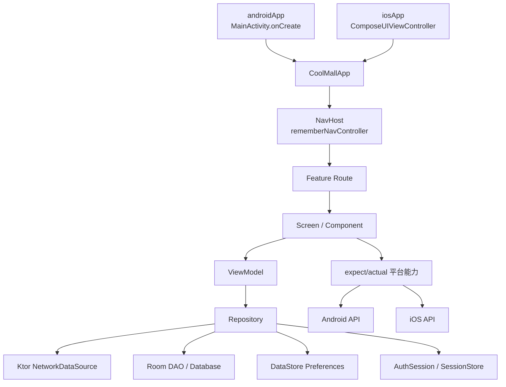
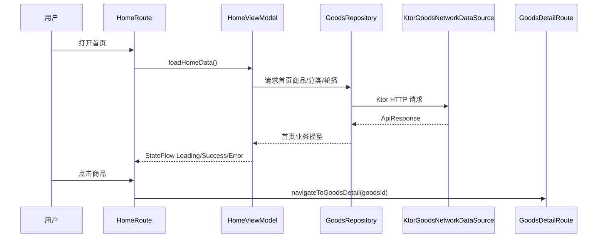
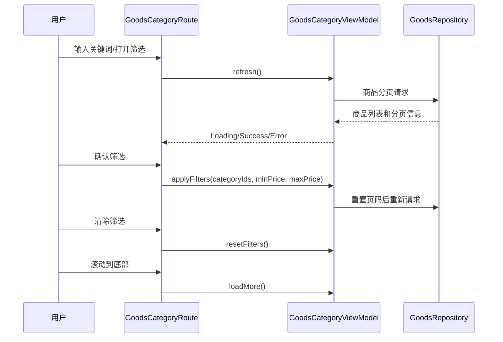
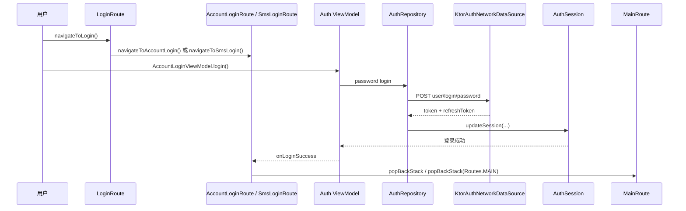
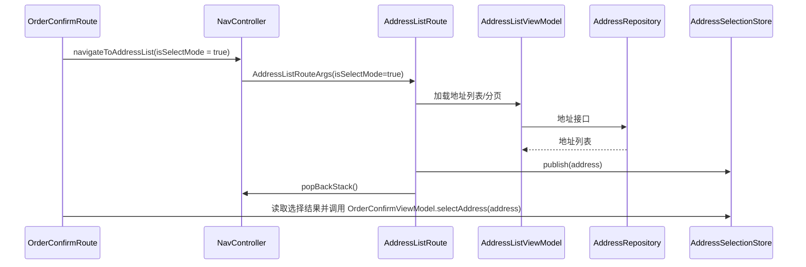
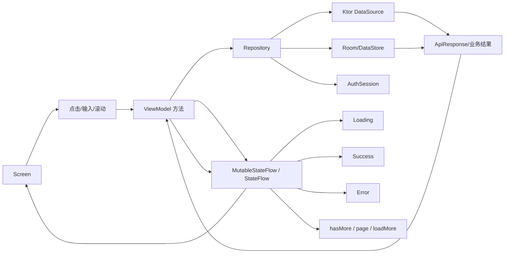

# CoolMallKMP APP 组织架构与数据流

本文是 CoolMallKMP 的业务地图，回答三个问题：

1. 页面从哪里进入、通过什么路由打开、从哪里返回。
2. 用户操作如何经过 `Route/Screen -> ViewModel -> Repository -> DataSource`。
3. 网络、本地数据库、会话和平台能力分别在哪里进出。

代码路径均以当前仓库为准。`Route` 是导航注册层使用的页面入口，`Screen` 是页面 UI，`ViewModel` 负责状态和事件，`Repository` 负责业务数据组合。

## 1. 总体组织架构



### 目录职责

| 目录 | 作用 |
| --- | --- |
| `androidApp` | Android Activity、Manifest、图标、通知和启动配置 |
| `iosApp` | iOS App 生命周期、窗口和平台资源 |
| `shared/.../ui` | Compose 根入口、主题和根导航 |
| `shared/.../feature/*/navigation` | 类型安全路由、参数和 `navigateTo...()` |
| `shared/.../feature/*/view` | Route、Screen、页面组件 |
| `shared/.../feature/*/viewmodel` | `StateFlow`、加载/提交/分页和用户事件 |
| `shared/.../core/data/repository` | 网络、本地、会话数据的业务组合 |
| `shared/.../core/network` | Ktor 请求和响应解析 |
| `shared/.../core/database` | Room Database、Entity、DAO |
| `shared/.../core/platform` | WebView、通知、文件选择等平台实现 |
| `shared/.../core/ui` | Scaffold、Card、Loading、Modal、列表等公共 UI |

## 2. APP 启动链路

```mermaid
flowchart LR
    A[MainActivity.onCreate] --> B[installSplashScreen]
    B --> C[enableEdgeToEdge]
    C --> D[initializeCoolMallAndroid]
    D --> E[setContent { CoolMallApp() }]
    E --> F[NavHost startDestination=Routes.SPLASH]
    F --> G[SplashRoute]
    G --> H[SplashViewModel]
    H --> I{SplashPreferences<br/>是否完成启动检查}
    I -- 首次启动 --> J[navController.navigateToGuide]
    I -- 已启动 --> K[navController.navigateToMain]
    J --> L[GuideRoute]
    L --> M[GuideViewModel.updatePageIndex]
    L --> N[navigateFromGuideToMain]
    N --> O[MainRoute]
    K --> O
```

### 实际关键符号

- Android 入口：`androidApp/src/main/kotlin/com/joker/coolmall/MainActivity.kt`
  - `MainActivity.onCreate()`
  - `CoolMallApp()`
- Android 初始化：`shared/src/androidMain/kotlin/com/joker/coolmall/MainActivityBootstrap.kt`
  - `initializeCoolMallAndroid(...)`
- 根入口：`shared/src/commonMain/kotlin/com/joker/coolmall/ui/CoolMallApp.kt`
  - `CoolMallApp()`
- 根路由：`shared/src/commonMain/kotlin/com/joker/coolmall/ui/navigation/Routes.kt`
  - `Routes.SPLASH`
  - `Routes.GUIDE`
  - `Routes.MAIN`
- 启动导航：`feature/launch/navigation/LaunchNavigation.kt`
  - `navigateToGuide(fromSettings)`
  - `navigateToMain()`
  - `navigateFromGuideToMain()`

从设置重新查看引导时调用 `navigateToGuide(fromSettings = true)`，不会按首次启动逻辑清掉 Splash 路由。

## 3. 根导航和页面关系

```mermaid
flowchart TB
    ROOT[CoolMallApp / NavHost] --> SPLASH[SplashRoute<br/>Routes.SPLASH]
    ROOT --> GUIDE[GuideRoute<br/>Routes.GUIDE]
    ROOT --> MAIN[MainRoute<br/>Routes.MAIN]

    MAIN --> HOME[HomeRoute]
    MAIN --> CATEGORY[CategoryRoute]
    MAIN --> CART[CartRoute]
    MAIN --> ME[MeRoute / ProfileRoute]

    HOME --> SEARCH[GoodsSearchRoute<br/>GoodsSearchRouteArgs]
    HOME --> DETAIL[GoodsDetailRoute<br/>GoodsDetailRouteArgs(goodsId)]
    CATEGORY --> RESULT[GoodsCategoryRoute<br/>GoodsCategoryRouteArgs]
    CATEGORY --> DETAIL
    CART --> CONFIRM[OrderConfirmRoute]
    ME --> AUTH{AuthSession.token}
    AUTH -- 空 --> LOGIN[LoginRoute]
    AUTH -- 有 --> PROFILE[ProfileRoute]

    ME --> SETTINGS[SettingsRoute]
    ME --> FEEDBACK[FeedbackListRoute]
    ME --> ADDRESS[AddressListRoute]
    ME --> ORDER[OrderListRoute]
    ME --> CHAT[ChatRoute]
    ME --> ABOUT[AboutRoute]
```

`CoolMallApp.kt` 是实际组装点。`mainScreen(...)` 的回调在这里接到具体导航方法，并且在地址、订单、优惠券、足迹、反馈、客服等受保护入口统一检查 `AuthSession.token`。

## 4. 商品、搜索和购物车数据流

### 首页进入商品



### 搜索入口到搜索结果

```mermaid
flowchart LR
    A[GoodsSearchRoute] --> B[GoodsSearchViewModel]
    B --> C[loadKeywords()]
    C --> D[GoodsRepository]
    D --> E[热门搜索接口]
    B --> F[SearchHistoryRepository]
    F --> G[Room SearchHistoryDao]
    A --> H[commitSearch(raw)]
    H --> F
    H --> I[navigate GoodsCategoryRouteArgs]
    I --> J[GoodsCategoryRoute]
    J --> K[GoodsCategoryViewModel]
    K --> L[refresh()]
    K --> M[loadMore()]
    L --> N[GoodsRepository 商品分页接口]
    M --> N
```

实际导航：

- 搜索入口：`navigateToGoodsSearch()`。
- 搜索提交：`CoolMallApp.kt` 中构造 `GoodsCategoryRouteArgs(title = keyword, keyword = keyword)`，并对 `GoodsSearchRouteArgs` 做 `popUpTo(..., inclusive = true)`。
- 结果页继续搜索：`goodsCategoryScreen(onSearch = { args, keyword -> ... })` 调用 `navigateToGoodsCategory(...)`。
- 商品详情：`navigateToGoodsDetail(goodsId)`。
- 商品评论：`navigateToGoodsComments(goodsId)`。

### 筛选和分页



购物车由 `MainRoute` 内的 `CartViewModel` 维护。商品详情页进入结算时调用 `navigateToOrderConfirm()`；购物车选中商品后通过 `onCheckoutClick` 进入同一个订单确认页。

## 5. 登录、验证码和会话



短信登录的实际方法：

- `SmsLoginViewModel.updatePhone(...)`
- `SmsLoginViewModel.updateSmsCode(...)`
- `SmsLoginViewModel.refreshCaptcha()`
- `SmsLoginViewModel.sendSmsCode()`
- `SmsLoginViewModel.login()`
- `AccountLoginViewModel.login()`
- `RegisterViewModel.sendSmsCode()`、`RegisterViewModel.register()`

验证码接口成功后，平台通知由 `VerificationNotification` 的 Android/iOS 实现处理。微信/QQ 登录仍是 SDK 边界，不在共享业务流中伪造。

## 6. 我的、地址和订单

### 未登录拦截

```mermaid
flowchart LR
    A[MainRoute 我的/地址/订单/反馈/客服] --> B{AuthSession.token.isNotBlank()}
    B -- 否 --> C[navigateToLogin()]
    B -- 是 --> D[进入受保护页面]
```

当前 `CoolMallApp.kt` 中受保护的入口包括：

- `onProfileClick`
- `onAddressClick`
- `onOrderListClick(tabIndex)`
- `onCouponClick`
- `onFootprintClick`
- `onFeedbackClick`
- `onCustomerServiceClick`
- 设置页的 `onAccountSecurityClick`、`onFeedbackClick`

### 地址



地址相关导航：

- `navigateToAddressList(isSelectMode)`
- `navigateToAddressEdit(addressId)`
- `AddressListRouteArgs`
- `AddressEditRouteArgs`
- `AddressSelectionStore.publish(address)`

### 订单

```mermaid
flowchart TB
    A[OrderConfirmRoute] --> B[OrderConfirmViewModel.loadConfirmPage]
    B --> C[OrderRepository]
    C --> D[确认订单接口]
    A --> E[navigateToOrderResult(orderId, orderNum, amount)]
    E --> F[OrderResultRoute]
    F --> G[navigateToOrderPay(orderId, price, from=confirm)]
    G --> H[OrderPayRoute]
    H --> I{支付结果}
    I -- confirm 成功 --> J[navigateToOrderDetail(orderId)]
    I -- list/detail 返回 --> K[popBackStack]

    L[OrderListRoute] --> M[OrderListViewModel.selectTab]
    M --> N[refresh(tabIndex) / loadMore(tabIndex)]
    N --> O[OrderRepository]
    L --> P[navigateToOrderDetail/orderLogistics/orderRefund/orderComment/orderPay]
```

订单关键导航方法：

- `navigateToOrderConfirm()`
- `navigateToOrderResult(orderId, orderNum, amount)`
- `navigateToOrderList(initialTabIndex)`
- `navigateToOrderDetail(orderId)`
- `navigateToOrderLogistics(orderId)`
- `navigateToOrderRefund(orderId)`
- `navigateToOrderComment(orderId, goodsId)`
- `navigateToOrderPay(orderId, price, from)`
- `backToMainFromOrder()`

## 7. 反馈、Web、设置和客服

### 反馈

```mermaid
flowchart LR
    A[FeedbackListRoute] --> B[FeedbackListViewModel]
    B --> C[FeedbackRepository]
    C --> D[POST app/feedback/page]
    A --> E[navigateToFeedbackSubmit()]
    E --> F[FeedbackSubmitRoute]
    F --> G[FeedbackSubmitViewModel.submit()]
    G --> H[FileUploadRepository]
    H --> I[POST base/comm/upload<br/>multipart]
    I --> J[COS 上传文件]
    J --> K[FeedbackRepository.submit]
    K --> L[POST app/feedback/submit]
```

反馈页面的实际 ViewModel 方法包括：

- `FeedbackListViewModel`：列表加载/刷新/加载更多。
- `FeedbackSubmitViewModel.loadTypes()`
- `FeedbackSubmitViewModel.selectType(...)`
- `FeedbackSubmitViewModel.updateContact(...)`
- `FeedbackSubmitViewModel.updateContent(...)`
- `FeedbackSubmitViewModel.onImagesPicked(...)`
- `FeedbackSubmitViewModel.submit()`

### Web 和文档

```mermaid
flowchart LR
    A[AboutRoute / LoginRoute / SettingsRoute] --> B[navigateToWeb(url, title)]
    B --> C[WebRouteArgs]
    C --> D[WebRoute]
    D --> E[Android WebView]
    D --> F[iOS WKWebView]
    D --> G[标题/刷新/加载状态]

    H[navigateToUserAgreement] --> I[DocumentRoute]
    J[navigateToPrivacyPolicy] --> I
```

### 设置和客服

- 设置：`navigateToSettings()` -> `SettingsRoute`
  - 主题：`SettingsViewModel`
  - 语言展示、清除缓存、重新查看引导、协议/隐私、反馈和关于入口
  - 重新引导：`navigateToGuide(fromSettings = true)`
- 客服：`navigateToChat()` -> `ChatRoute`
  - `ChatViewModel.updateInputText(...)`
  - `ChatViewModel.loadMore()`
  - `ChatViewModel.sendMessage()`
  - `ChatViewModel.onImagesPicked(...)`
  - WebSocket 实时消息 + 历史倒序分页

## 8. 通用状态和数据流



常见页面生命周期：

1. `Route` 注册页面并传入导航回调。
2. `Screen` 获取对应 ViewModel，收集 `StateFlow`。
3. 用户事件调用 ViewModel 的公开方法。
4. ViewModel 调用 Repository。
5. Repository 调用 Ktor、Room、DataStore 或会话存储。
6. ViewModel 更新状态，Screen 渲染加载、内容、空态或错误。
7. 返回页面时由 `popBackStack()`、`LifecycleResumeEffect` 或结果存储触发刷新。

## 9. 关键路由和方法索引

| 业务 | Route / 参数 | 进入方法 | 主要 ViewModel 方法 |
| --- | --- | --- | --- |
| 启动 | `SplashRoute` | `Routes.SPLASH` | 启动状态检查 |
| 引导 | `GuideRoute` | `navigateToGuide(fromSettings)` | `updatePageIndex()` |
| 主页面 | `MainRoute` | `navigateToMain()` | `HomeViewModel.loadHomeData()`、`onRefresh()` |
| 搜索入口 | `GoodsSearchRoute` | `navigateToGoodsSearch()` | `loadKeywords()`、`commitSearch()` |
| 搜索结果 | `GoodsCategoryRouteArgs` | `navigateToGoodsCategory(...)` | `refresh()`、`loadMore()`、`applyFilters()`、`resetFilters()` |
| 商品详情 | `GoodsDetailRouteArgs(goodsId)` | `navigateToGoodsDetail(goodsId)` | `loadDetail()`、`loadGoodsSpecs()` |
| 登录 | `LoginRoute` | `navigateToLogin()` | `AccountLoginViewModel.login()`、`SmsLoginViewModel.login()` |
| 地址 | `AddressListRouteArgs` | `navigateToAddressList(...)` | 地址分页、删除、选择 |
| 订单确认 | `OrderConfirmRoute` | `navigateToOrderConfirm()` | `loadConfirmPage()`、`selectAddress()`、`submitOrder()` |
| 订单 | `Order*RouteArgs` | `navigateToOrderList/Detail/...` | `refresh()`、`loadMore()`、`load()` |
| 反馈 | `Feedback*RouteArgs` | `navigateToFeedbackList/Submit()` | `submit()`、上传图片 |
| Web | `WebRouteArgs(url,title)` | `navigateToWeb(...)` | 动态标题、刷新、加载状态 |
| 设置 | `SettingsRoute` | `navigateToSettings()` | 主题、缓存、引导 |
| 客服 | `ChatRoute` | `navigateToChat()` | `sendMessage()`、`loadMore()` |

## 10. 当前边界

- 微信/QQ 登录与绑定依赖第三方 SDK，当前不属于共享层已完成能力。
- 支付 SDK 按项目约定暂不迁移；订单创建、支付页展示和支付结果导航仍存在，但实际 SDK 支付能力不在本图承诺范围内。
- 重置密码最终提交接口仍需后端接口确认。
- Android 通知、Android WebView、iOS `UNUserNotificationCenter`/WKWebView、图片选择等系统能力通过平台 `expect/actual` 接入。
- 本文描述的是当前代码流转，不等同于所有页面已经与 `CoolMallKotlin` 做到像素级 UI 一致。
